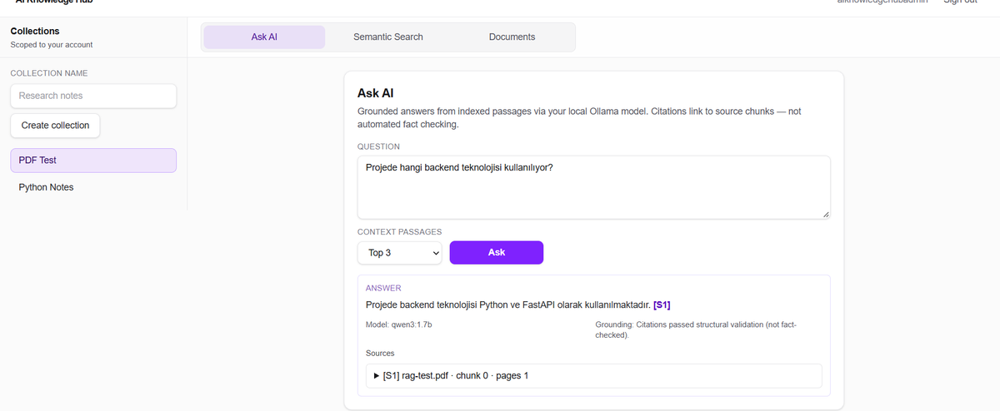
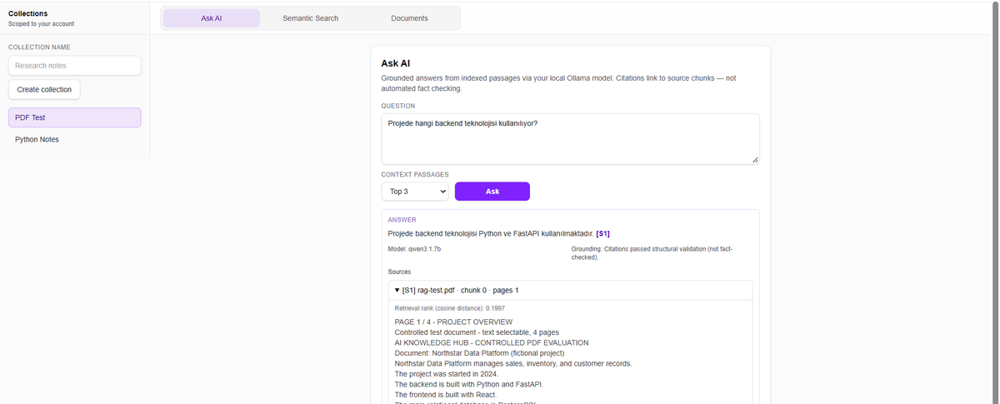
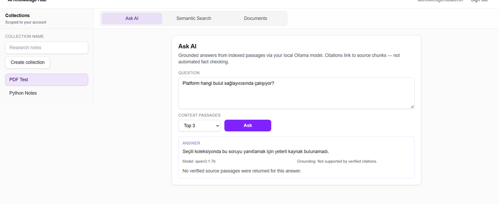
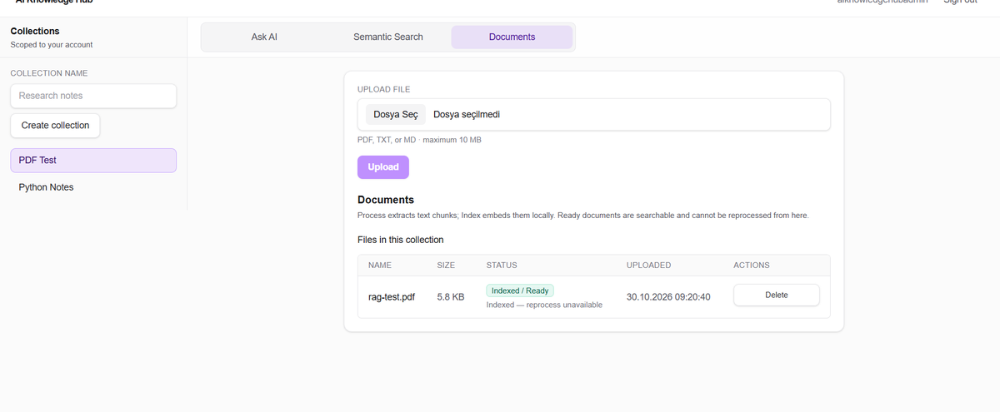
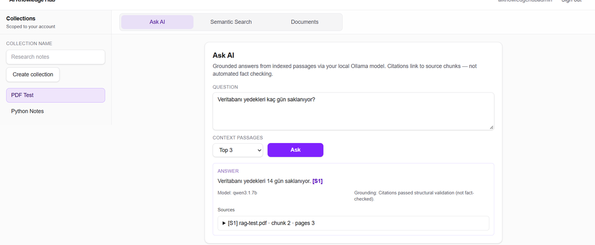

# AI Knowledge Hub (Yapay Zekâ Bilgi Merkezi)

[English](README.md) | **Türkçe**

**Belgelerinize soru sorun; yapay zekâ yanıtları kaynak referanslarıyla birlikte gelsin.**

AI Knowledge Hub; dosyalarınızı koleksiyonlarda toplayan, anlamsal arama yapan ve **yerel modellerle** soru yanıtlayan tam yığın bir uygulamadır. **Portföy demosudur**; herkese açık bir **canlı demo adresi yoktur**—web arayüzü, API, PostgreSQL, gömme modeli ve Ollama’yı kendi bilgisayarınızda çalıştırırsınız.

Aşağıdaki ekran görüntüleri, sentetik değerlendirme dosyası **`rag-test.pdf`** (kurgusal “Northstar Data Platform” metni) ile alınmıştır. Metindeki kurum/altyapı bilgileri **bu repodaki gerçek üretim ortamını veya iş politikalarını yansıtmaz**.



## Uygulama ne yapar?

- **Kişisel koleksiyonlar** — Giriş yapın; her kullanıcı yalnızca kendi koleksiyon ve belgelerini görür.
- **Yükleme** — PDF, TXT veya Markdown (boyut ve tür denetimi).
- **İşle & indeksle** — Metin çıkarımı, parçalara ayırma, **çok dilli E5** ile gömme, **PostgreSQL + pgvector**’e kayıt.
- **Anlamsal arama** — Sorguyu anlamına göre parçalarla eşleştirir (kosinüs mesafesi), koleksiyon kapsamlı. *(Ekran görüntüsünde yok; Ask AI ile aynı arama altyapısını kullanır.)*
- **Ask AI** — Parçaları getirir, **Ollama (qwen3:1.7b)** ile yanıt üretir, atıf ve alıntıları doğrular—kanıt yetersizse **cevap vermez**.

## Ekran görüntüleri (demo verisi)

| | |
| --- | --- |
| <br>*Kaynak **[S1]** açık: parça metni, sayfalar, kosinüs mesafesi.* | <br>*Doğrulanmış parça yok — uydurma cevap yok.* |
| <br>*Yükle → işle → indeksle → **Ready**.* | <br>*Tek bilgi tipi; çok parçalı sorular tutarlı yanıtlanmayabilir.* |

## Belgeler yanıta nasıl dönüşür?

Model tüm arşivi görmez—yalnızca getirilen birkaç parçayı kullanır.

```
Yükleme → metin çıkarımı → parçalama → E5 gömme → pgvector
Soru → sorgu gömme → en ilgili parçalar → Ollama JSON yanıtı
→ atıf / alıntı doğrulama → kaynaklar veya çekimserlik
```

**Atıflar** — Kaynak kimlikleri ve destek alıntıları getirilen metinle eşleşmelidir (**yapısal** doğrulama). Birçok uydurma veya desteksiz ifade elenir; bu **tam anlamsal doğruluk** değildir.

**Güvenilirlik** — 5D denetimi: sahiplik testleri, işleme/indeksleme sırasında atomik silme, CI’da PostgreSQL entegrasyon testleri. Bu, **kurumsal güvenlik veya SLA** iddiası değildir.

## Mimari ve teknoloji

| Katman | Teknoloji |
| ------ | --------- |
| Arayüz | Next.js, TypeScript, Tailwind |
| Kimlik | Neon Auth → API’ye JWT |
| API | FastAPI, SQLAlchemy 2, uv |
| Veri | PostgreSQL 17, pgvector, Alembic |
| Gömme | `intfloat/multilingual-e5-small` (yerel CPU) |
| Yanıt | Ollama `qwen3:1.7b` (yalnızca sunucu tarafı) |

```
apps/web ──JWT/REST──► services/api ◄──► PostgreSQL (pgvector)
                           ├── yerel dosya depolama
                           ├── Sentence Transformers (E5)
                           └── Ollama HTTP
```

## Testler ve CI

[](https://github.com/mehmetgorer/ai-knowledge-hub/actions/workflows/ci.yml)

`main` dalına her push’ta:

1. **Frontend** — lint, typecheck, birim testler, build  
2. **Backend** — Ruff, **180+** birim test  
3. **Backend integration** — pgvector’lü geçici Postgres’te **95+** test  

Ayrıntı: [`docs/QUALITY_AUDIT.md`](docs/QUALITY_AUDIT.md)

```powershell
npm run lint && npm run typecheck && npm run test --workspace=web && npm run build
cd services/api && uv run ruff check . && uv run pytest && uv run pytest -m integration
```

## Yerel kurulum

Gereksinimler: Node.js, Python 3.12+, [uv](https://docs.astral.sh/uv/), Docker (Postgres), [Ollama](https://ollama.com), Neon Auth ortam değişkenleri. `.env` / `.env.local` commit etmeyin.

1. **Veritabanı** (repo kökü): `Copy-Item .env.example .env` → `docker compose up -d` (varsayılan port **5433**).  
2. **API** (`services/api`): `uv sync` → `.env` içinde `AUTH_*` ve Ollama → `uv run alembic upgrade head` → `uv run ai-knowledge-hub-api` → `ollama pull qwen3:1.7b`.  
3. **Web**: `npm install` → `apps/web/.env.local` (`.env.example`) → `npm run dev` → [http://localhost:3000/dashboard](http://localhost:3000/dashboard).

Faz notları: [`docs/HANDOFF.md`](docs/HANDOFF.md)

## Bilinen sınırlar

- Yalnızca yerel MVP; repoda barındırılmış canlı sürüm yok.  
- Atıf doğrulaması mükemmel cevap garantisi vermez; karmaşık çok adımlı sorular kısmen yanlış veya çekimser olabilir.  
- İşleme/indeksleme API sürecinde senkron; çökme sonrası belge takılı kalabilir.  
- CI Ask testlerinde Ollama mock’lanır; gerçek kalite için yerel Ollama denemesi gerekir.
